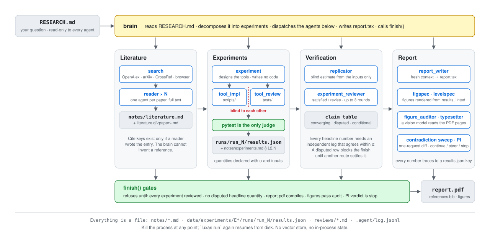
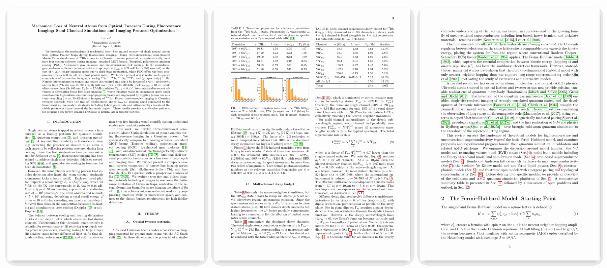
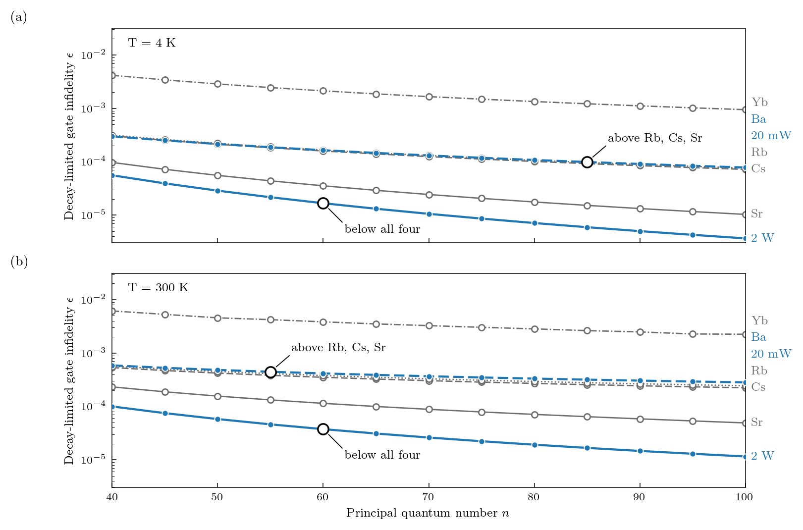
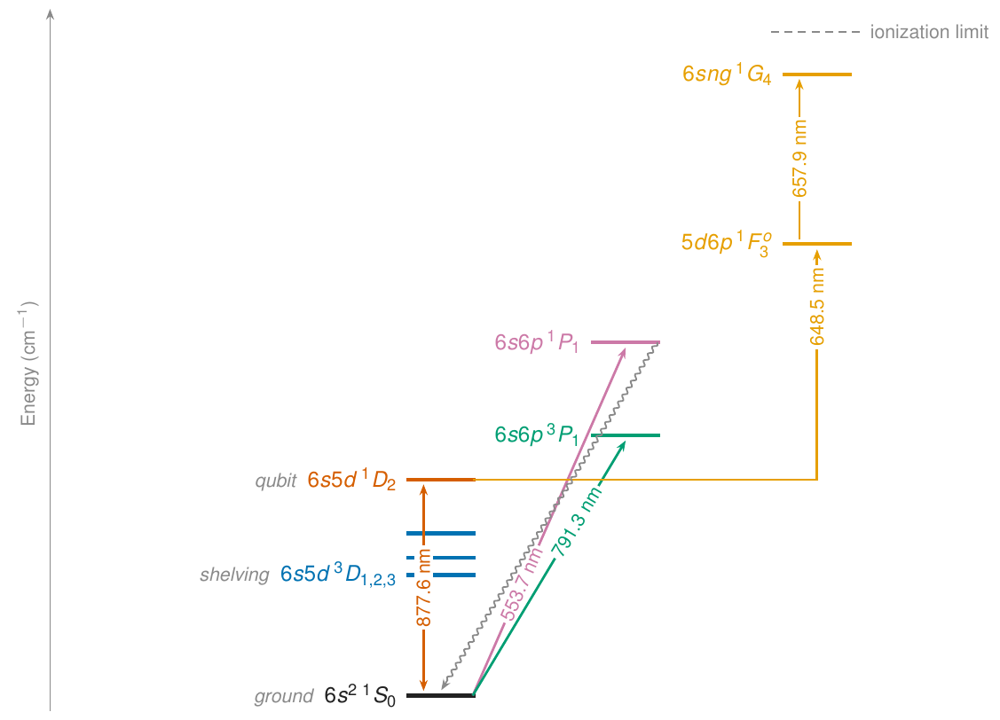

<div align="center">

# Luxas

**An autonomous research agent: from a one-line question to a compiled, reviewed LaTeX report.**

[![][node-shield]][node-link]
[![][typescript-shield]][ts-link]
[![][pi-mono-shield]][pi-mono-link]
[![][license-shield]][license-link]

[luxas.im](https://luxas.im) · [Gallery](https://luxas.im/gallery) · [Quick start](#quick-start) · [How it works](#how-it-works) · [Architecture notes](docs/architecture.md) · [Contributing](CONTRIBUTING.md)

</div>

<picture>
  <source media="(prefers-color-scheme: dark)" srcset="docs/assets/pipeline-dark.svg">
  
</picture>

Give Luxas a research question in `RESEARCH.md`. It surveys the literature, designs and runs the experiments, draws the figures, writes the report, and hands all of it to reviewers that are built to disagree with it. It runs for hours unattended, survives crashes, and ends with a PDF in which every number traces back to a result file.

Luxas is a harness, not a model. Claude, DeepSeek, GLM and OpenAI models sit behind one routing layer, and the agent loop comes from [pi-mono](https://github.com/badlogic/pi-mono).

## What comes out

<picture>
  <source media="(prefers-color-scheme: dark)" srcset="docs/assets/report-pages-dark.png">
  
</picture>

Nine end-to-end runs are at [luxas.im/gallery](https://luxas.im/gallery). Each started from one `luxas init --prompt "…"`; no human wrote in the manuscripts, though a few runs needed a restart. The pages above are from *Mechanical loss of neutral atoms from optical tweezers*, *Microwave superradiance in Rydberg arrays* and *Beyond the Fermi–Hubbard model*.

Figures are rendered by Luxas's own renderers from the experiment's result files, linted for composition, then read back by a vision model before the report may finish:

<table>
  <tr>
    <td width="60%"></td>
    <td width="40%"></td>
  </tr>
</table>

## Quick start

Agents shell out to LaTeX, Python and tmux, so `npm install` alone is not enough:

```bash
# macOS
brew install --cask mactex                   # or basictex
brew install poppler tmux python@3.11 && pip3 install matplotlib numpy

# Debian / Ubuntu
sudo apt install texlive-latex-extra texlive-fonts-recommended poppler-utils tmux python3-matplotlib python3-numpy
```

Install and run (Node.js 22+):

```bash
git clone https://github.com/Muuuun/luxas.git && cd luxas
npm install && npm link                      # `luxas` on PATH; or `npx tsx src/index.ts`

export DEEPSEEK_API_KEY=…  GLM_API_KEY=…     # the default profile
export ANTHROPIC_API_KEY=…                   # for --profile claude or an Opus brain

luxas init   ~/research/x --prompt "Mechanical loss of atoms from optical tweezers during imaging"
luxas run    ~/research/x --max-cost 30
luxas status ~/research/x                    # progress, agents in flight, spend so far
luxas list                                   # every project Luxas has touched
```

Every sub-agent gets its own tmux window, so you can watch a run live. You can also talk to a running project without touching it: `luxas monitor ~/research/x --message "what is E2 waiting on?"`.

**Models.** `--profile dual` is the default: DeepSeek for text and drawing, GLM for the figure audit. `--profile claude` puts every agent on Anthropic. `LUXAS_BRAIN_MODEL=claude-opus-5-5 luxas run …` keeps the cheap producers and gives the orchestrator the strongest model; that is the configuration most of the measured runs used. The hard cost cap defaults to $250 per run, `--max-cost` lowers it, and the real spend of every run is in `<project>/.agent/usage.log`.

## How it works

The diagram at the top is the whole system. Five rules hold it together:

- **The brain never writes code or tests.** `experiment` designs the tools; `tool_impl` writes the code and `tool_review` writes the tests from the same description, blind to each other. Pytest is the only judge. This closed the failure where an implementation redefined a field so that its own test passed.
- **Every headline number is a claim.** Results declare quantities with σ and inputs. A `replicator` that sees only the inputs estimates each one blind; the claim table marks rows converging or disputed, and a disputed row blocks `finish()` until an independent route settles it.
- **Reviewers are built to disagree.** A fresh `experiment_reviewer` after every experiment, a PI that returns continue / steer / stop, a one-request contradiction sweep across the report and the ledger, and a vision model that reads the compiled pages.
- **Gates are code, not prompt.** `finish()` is the only clean exit and refuses until its checks pass. The cost cap, write protection and spawn scope are hooks and tool wrappers that no prompt can talk past.
- **Everything is a file.** Notes, results, reviews and the session log live on disk, and `luxas run` again resumes from them. No vector store, no in-process state.

The agent roster, the safety table and the comparison with other frameworks are in [docs/architecture.md](docs/architecture.md). The design history is in [idea.md](idea.md).

## Project layout

```
project/
  RESEARCH.md                   your question, read-only to every agent
  notes/                        literature.md · experiments.md · memory.md
  data/experiments/E1_slug/     scripts/ · tests/ · runs/run_N/results.json
  report/                       report.tex · references.bib · figures/ · report.pdf
  reviews/                      pi_feedback.md · experiment_review_*.md
  .agent/                       log.jsonl · checkpoint.jsonl · usage.log
```

## Development

```bash
npm test            # tsc + 100-odd offline gates, no API calls
npm run test:live   # gates that call real models (slow, billed)
```

Each agent is a markdown file in `src/agents/definitions/` with YAML frontmatter for its model, tools, spawn rights and write scope; adding one is a `.md` edit. See [CONTRIBUTING.md](CONTRIBUTING.md).

## Security

Luxas runs shell commands, Python and `pip install` unattended inside the project directory. Tool wrappers block reads of credential files and key variables, but that is defence in depth, not a sandbox. Run it as a non-root user in a directory that holds nothing you would not hand to a script. Report security issues in a GitHub issue tagged `security`.

## Citation

```bibtex
@software{luxas2026,
  author = {Mu Qiao},
  title  = {Luxas: an autonomous research agent for end-to-end literature survey,
            experiment design, and LaTeX report generation},
  year   = {2026},
  url    = {https://github.com/Muuuun/luxas}
}
```

## Acknowledgments

Built on [pi-mono](https://github.com/badlogic/pi-mono) by [Mario Zechner](https://mariozechner.at/). Prompt evolution via [AgentSmelt](https://github.com/Muuuun/agentsmelt); number provenance via [provref](https://github.com/Muuuun/provref). Token sponsorship from [Deeplang 深言科技](https://www.deeplang.ai/).

## License

MIT — see [LICENSE](LICENSE).

[node-shield]: https://img.shields.io/badge/node-22+-4dc9f6?style=flat-square&labelColor=0a0e14&logo=node.js&logoColor=4dc9f6
[node-link]: https://nodejs.org/
[typescript-shield]: https://img.shields.io/badge/typescript-5.5+-7dd8f8?style=flat-square&labelColor=0a0e14&logo=typescript&logoColor=7dd8f8
[ts-link]: https://www.typescriptlang.org/
[pi-mono-shield]: https://img.shields.io/badge/pi--mono-vendored-b0e8ff?style=flat-square&labelColor=0a0e14
[pi-mono-link]: https://github.com/badlogic/pi-mono
[license-shield]: https://img.shields.io/badge/license-MIT-b0e8ff?style=flat-square&labelColor=0a0e14
[license-link]: LICENSE
